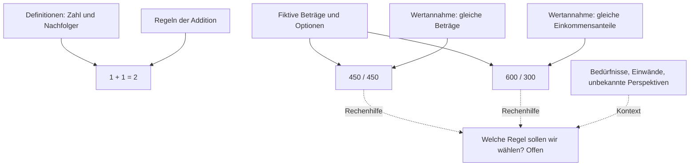

# Beweisraum · Das Leben in prüfbaren Ausschnitten

**Arbeitsstand 0.1 · 11. November 2026 · KI-erstellter Forschungsentwurf, alle Einträge R0.**

Hier suchen wir nach tragfähigen philosophischen Argumenten, bedingten Beweisen und Gegenbeispielen. Wir beginnen mit kleinen Aussagen und halten sichtbar, was von welchen Voraussetzungen abhängt. Das Leben bleibt größer als seine Darstellung. Eine ausgelassene Perspektive oder ein schlechter Begriff kann das ganze Modell infrage stellen.

Der Raum liegt vollständig unter `research/beweisraum/`. Er wird nicht in die Website, das öffentliche Aussagenregister oder einen laufenden Schwarm importiert. Ein Ordner schafft eine Arbeitsgrenze; eine technische Sandbox oder Zugriffskontrolle schafft er nicht. Die vorhandenen Projektregeln gelten weiter.

## Hier anfangen

| Frage | Ort |
| --- | --- |
| Warum passt das zu Vera? Was trägt an „Philosophie = Mathematik“? | [Grundlagen](GRUNDLAGEN.md) |
| Wie bilden wir einen Ausschnitt des Lebens ab? | [Fiktiver Mietfall](LEBENSFALL.md) |
| Welche Aussagen und Abhängigkeiten gibt es? | [Lesbares Register](#erster-bestand) und [strukturierter Graph](room.json) |
| Wie kann ein Agent sinnvoll mitarbeiten? | [Arbeitsregeln](AGENTS.md) und [Prüfplan](PRUEFPLAN.md) |
| Was wurde tatsächlich zuerst untersucht? | [Prüfplan und erste KI-Gegenprüfung](PRUEFPLAN.md#erste-gegenpruefung) |

## Warum dieser Ort zu Vera passt

Der [mathematische Prüfstand M-01](../../docs/mathematischer-pruefstand.md) sucht bereits nach Axiomen, Gegenmodellen und Grenzen. [M-03](../../docs/philosophischer-motor-mathematik.md) trennt formale Gültigkeit, empirische Belege und normative Voraussetzungen und entwirft einen typisierten Wissensgraphen. Der [Grundfragen-Kreislauf](../../docs/grundfragen-kreislauf.md) sammelt übergreifende Fragen. Dieser Raum erprobt diese Arbeit an einem kleinen, expliziten Graphen, ohne die bestehenden Register umzuschreiben.

**Gemeinsame Denkwerkzeuge sind eine Verbindung, kein Identitätsbeweis.** Die vorherige Erklärung zu „Philosophie = Mathematik“ ist hier eine methodische Analogie. Eine stärkere wörtliche Gleichsetzung bleibt unbegründet. C-006 hält diese Einschränkung fest; C-007 enthält ein Gegenmodell gegen den Schluss von Gemeinsamkeiten auf Gleichheit.

## Was als Ergebnis zählt

| Aussageart | Was wir suchen | Was offenbleiben kann |
| --- | --- | --- |
| Formal | Explizite Voraussetzungen, Ableitung oder Gegenmodell | Ob die Voraussetzungen das wirkliche Leben treffen |
| Empirisch | Quellen, Beobachtungen, Vergleich und mögliche Widerlegung | Wirkung, Kausalität, Übertragbarkeit |
| Normativ | Benannte Werte, Betroffene, Konflikte und begründete Alternativen | Welcher Wert Vorrang haben soll |
| Interpretativ | Text- und Kontextgründe, andere Lesarten | Eine eindeutige Deutung |
| Metaphorisch | Tragende Gemeinsamkeiten und entscheidende Unterschiede | Wörtliche Gleichheit |

Ein gescheiterter Beweis, ein Gegenbeispiel, eine eingegrenzte Behauptung und eine präziser gewordene offene Frage sind brauchbare Ergebnisse. Die Anzahl zustimmender Agenten verändert keinen Befund. Die [Erkenntnisreife R0–R4](../../docs/erkenntnisreife.md) bezeichnet dokumentierte Prüfung; dieser Pilot vergibt ausschließlich R0 und bietet keine Beförderungsfunktion.

## Erster Bestand

Die Kennungen sind **lokal für diesen Raum**. Q-001 hier ist kein neuer Eintrag Q-001 im öffentlichen Fragenatlas. Definitionen und Annahmen bekommen ebenso wie Behauptungen einen Einwand und eine Revisionsbedingung.

| Kennung | Inhalt | Arbeitsstand |
| --- | --- | --- |
| D-001, A-001 → C-001 | Nachfolger, Addition und `1 + 1 = 2` | Ausgeschriebene bedingte Ableitung |
| D-002 → C-002 | Aus `p` allein folgt ein unabhängiges `n` nicht | Zwei aussagenlogische Gegenbelegungen |
| D-003 + A-002 → C-003 | 900 Euro zu gleichen Beträgen teilen | Je 450 Euro innerhalb des Modells |
| D-003 + A-003 → C-004 | 900 Euro proportional zu 3000/1500 Euro teilen | 600/300 Euro innerhalb des Modells |
| L-001 → C-005 | Welche Aufteilung sollen zwei Menschen wählen? | Normative Frage offen |
| C-006, D-004 → C-007 | Philosophie und Mathematik teilen Methoden | Gemeinsamkeit beweist keine Identität |
| Q-001 | Was verlieren wir, wenn wir Erleben in Felder übersetzen? | Offene Deutungsfrage |
| Q-002 | Hilft dieser Raum besser als ein schlichtes Prüfblatt? | Ungetestete empirische Frage |

Die Pfeile dieser Tabelle vereinfachen die Leseordnung. Verbindliche Ableitungsabhängigkeiten stehen in `premises` im [Graphen](room.json). Kontext-, Analogie- und Angriffskanten stehen gesondert in `links`; sie sind keine Beweisschritte.



## Lokal prüfen und Aufgaben verteilen

Node.js ab der im Repository angegebenen Version genügt; zusätzliche Pakete, Schlüssel oder ein Modellserver werden nicht gebraucht.

```sh
node research/beweisraum/room.mjs check
node research/beweisraum/room.mjs map de
node research/beweisraum/room.mjs brief C-006 de
node research/beweisraum/room.mjs impact D-003
node --test research/beweisraum/room.test.mjs
```

`brief` stellt vier getrennte Prüfaufträge bereit. Es startet keine Agenten. Ein Auftrag enthält die Raumfassung als SHA-256-Fingerabdruck und den Prämissenkontext. Ein Agent bearbeitet eine Frage in einem begrenzten Lauf und gibt einen Entwurf nach [Prüfplan](PRUEFPLAN.md) zurück. Neue Entwürfe werden zuerst lokal geprüft. Ein anderer Raum-Fingerabdruck markiert alte Entwürfe als veraltet; ihr Inhalt muss erneut gegen die geänderte Fassung gelesen werden.

`check` prüft Datenform, Grenzen, Knotenverweise und Ableitungszyklen. Es versteht keine Beweisprosa, authentifiziert keine Quellenlektüre und beweist keine philosophische Wahrheit. `impact` zeigt nur potenziell betroffene Folgerungen, keine automatische Widerlegung. Der Pilot umfasst höchstens 80 Knoten, 160 Beziehungen einschließlich Prämissen, acht Aufträge je geplantem Durchgang und 40 gespeicherte Entwürfe. Diese Grenzen verhindern keinen von außen unkontrolliert gestarteten Prozess.

## English

**Research draft 0.1, 11 November 2026. AI-generated, all entries R0.** This isolated repository workspace searches for precise philosophical arguments, conditional derivations, counterexamples and better questions. It extends Vera's existing [M-01](../../docs/mathematischer-pruefstand.md), [M-03](../../docs/philosophischer-motor-mathematik.md) and [universal questions](../../docs/grundfragen-kreislauf.md) without importing results into the website or public claim register.

“Philosophy = mathematics” is treated as a methodological analogy. Sharing methods does not establish identity. Formal validity, empirical support, normative justification, interpretation and metaphor remain distinct. The rent example derives 450/450 and 600/300 under different explicitly selected criteria; arithmetic does not choose the criterion or establish anyone's consent. Unknown perspectives and subjective experience remain visible gaps.

Use `map en` or `brief C-006 en` for English output. Every structured node has German and English text. `check` validates structure and bounded draft records, not truth or proof prose. `impact` follows premise dependencies only. The CLI is read-only and offline; `brief` creates instructions, not a running swarm. This directory is an organisational boundary, not a security sandbox. Read [the bilingual agent rules](AGENTS.md), [foundations](GRUNDLAGEN.md#english), [fictional case](LEBENSFALL.md#english) and [review plan](PRUEFPLAN.md#english) before contributing. Agent agreement never upgrades R0 or substitutes for independent evidence or documented human review.
